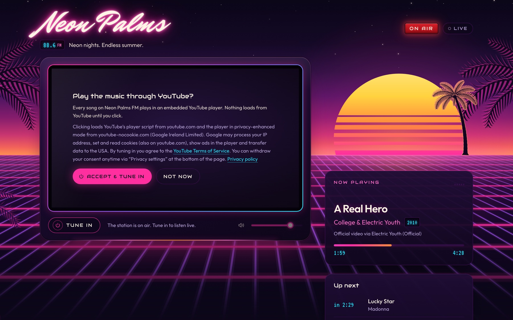
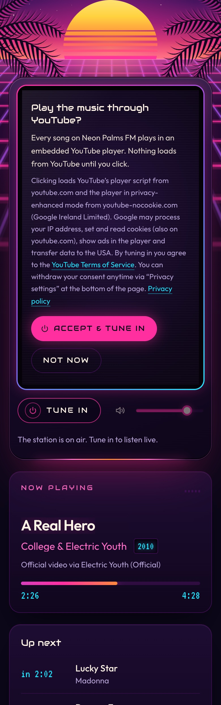
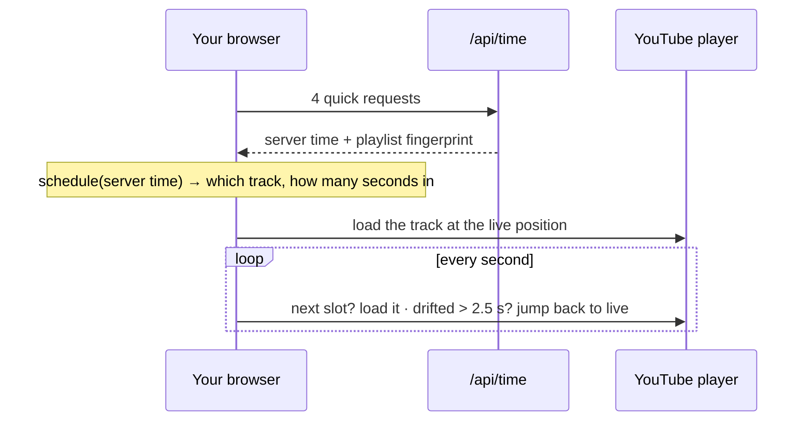

<div align="center">

# Neon Palms FM · 88.6

**Neon nights. Endless summer.**

An unofficial fan web radio with an 80s neon-sunset soul.<br>
Everyone hears the same song at the same moment — just like real radio.

[](https://github.com/MrScalo/neon-palms-radio/actions/workflows/ci.yml)


[](LICENSE)



</div>

## What it is

Neon Palms FM is a single-station web radio. The music comes from **official music videos** on the
artists' and labels' own YouTube channels, played in YouTube's embedded player — so anyone can listen
to full songs without an account.

The twist: it behaves like a real broadcast. There is no skip, no seek, no playlist to click through.
Tune in, and you land in the middle of whatever is on air right now — the same song, at the same
second, as every other listener.

<table>
<tr>
<td width="62%" valign="top">

### Features

- **Live for everyone** — a shared station clock keeps all listeners in sync (two browsers measured
  0.3 s apart), with automatic track changes and drift correction.
- **Real radio controls** — tune in / tune out, volume, mute. That's it.
- **On-air feel** — a studio-style ON AIR lamp, a LIVE pill when you're tuned in, Now Playing with a
  live progress bar, the next three songs, and a ticker of station bulletins.
- **48 hand-picked tracks** — 80s pop, synth-pop and new wave, night-drive rock and modern synthwave.
  Each one verified as an official upload ([The Rotation](src/data/playlist.json)).
- **Works before consent** — Now Playing and Up Next are computed locally, so the page is useful even
  if you never load YouTube.
- **Privacy by design** — nothing touches Google until you click _Accept & tune in_.
- **Original artwork** — the sun, palms and neon grid are hand-made CSS/SVG. No images, no fonts or
  scripts from third-party CDNs.
- **Responsive and accessible** — from 320 px phones to wide screens, keyboard friendly, honours
  _reduced motion_.

</td>
<td width="38%" valign="top" align="center">



</td>
</tr>
</table>

## How “live” works without a streaming server

There is no audio stream and no backend state. Every browser computes the same programme from the same
playlist and the same clock, then points its own YouTube player at the right second.



- **Station epoch.** The station “went on air” on 1 January 2026, 00:00 UTC
  ([`schedule.ts`](src/lib/radio/schedule.ts)). Time since then is cut into cycles; each cycle plays
  every track exactly once (about 3 h 24 min).
- **Same shuffle everywhere.** The cycle number seeds a small integer-only random generator, so every
  browser and JavaScript engine produces the identical order. No artist plays twice in a row — not even
  across the boundary between two cycles.
- **Server clock, not your clock.** [`clock.ts`](src/lib/radio/clock.ts) measures the offset to the
  server time, so a wrong computer clock doesn't matter. It re-syncs every 10 minutes and when you
  return to the tab.
- **Staying on air.** The [engine](src/lib/radio/engine.ts) follows the schedule every second, loads
  the next track exactly at the slot boundary and seeks back to the live position after buffering or a
  network hiccup. Temporary errors are retried; videos YouTube refuses are skipped until the next slot.
- **Playlist updates.** `/api/time` also returns a fingerprint of the playlist. A tab that was opened
  before an update shows _“The station has been updated”_ with a _Re-tune_ button instead of silently
  playing a different programme.

## Privacy by design

|                       | Before consent               | After “Accept & tune in”                                                   |
| --------------------- | ---------------------------- | -------------------------------------------------------------------------- |
| Requests              | Our own server only          | + `www.youtube.com` (IFrame API script) and `www.youtube-nocookie.com` (player) |
| Cookies               | None                         | YouTube may set its own cookies                                            |
| Stored on your device | Nothing                      | Your choice in `localStorage` (`neonpalms.consent.v1`)                     |
| Fonts                 | Self-hosted via `next/font`  | Self-hosted via `next/font`                                                |

- The consent card says exactly what will load and links to the privacy policy and YouTube's Terms of
  Service. _Not now_ is one click and is remembered without nagging.
- Consent can be withdrawn on every page under **Privacy settings** in the footer — the player is torn
  down immediately, in every open tab.
- A Content-Security-Policy ([`next.config.ts`](next.config.ts)) only allows those two YouTube hosts as
  third parties. No analytics, no ads of our own, no tracking.

## Playing by YouTube's rules

The site follows the [YouTube API Services policies](https://developers.google.com/youtube/terms/developer-policies)
for embedded players:

- The player is always visible (at least 200 × 200 px) and nothing is ever drawn on top of it.
- **No background playback.** When you switch to another tab, the station pauses; when you come back,
  it jumps straight back to the live position. The next track only starts by itself while at least
  half of the player is on screen.
- Only documented player parameters are used. If you pause by clicking the video, a _Back to live_
  button takes you back to the broadcast.

## Getting started

Requires **Node.js 20.9+** (CI uses Node 24).

```bash
git clone https://github.com/MrScalo/neon-palms-radio.git
cd neon-palms-radio
npm ci
npm run dev
```

Then open <http://localhost:3000>.

| Command                   | What it does                                                          |
| ------------------------- | --------------------------------------------------------------------- |
| `npm run dev`             | Development server                                                    |
| `npm run build`           | Production build                                                      |
| `npm start`               | Serve the production build                                            |
| `npm test`                | Unit tests (Vitest) — schedule, clock, consent, engine, UI helpers    |
| `npm run typecheck`       | TypeScript check                                                      |
| `npm run lint`            | ESLint                                                                |
| `npm run verify:playlist` | Re-checks every track against YouTube (needs internet)                |

> This project uses Next.js 16 with `cacheComponents`. Its APIs differ from older versions — the
> bundled docs in `node_modules/next/dist/docs/` are the reference.

## Project structure

```text
src/
├── app/
│   ├── page.tsx                 # the station
│   ├── api/time/route.ts        # station clock (dynamic, never cached)
│   ├── rotation/                # every track with a link to its official video
│   ├── privacy/ · imprint/      # privacy policy and legal notice
│   └── not-found.tsx            # “Dead air.”
├── components/
│   ├── radio/                   # set, controls, now playing, up next, ticker
│   │   └── scene/               # sun, palms, stars and grid (pure SVG/CSS)
│   └── legal/                   # footer with privacy settings, legal page layout
├── config/site.ts               # station identity + operator details (placeholders)
├── data/playlist.json           # the rotation
├── hooks/useRadio.ts            # React hook around the engine
└── lib/
    ├── consent.ts               # consent store (synced across tabs)
    └── radio/
        ├── schedule.ts          # deterministic programme
        ├── clock.ts             # server clock offset
        ├── engine.ts            # keeps the YouTube player on air
        └── youtube.ts           # IFrame API loader
scripts/verify-videos.mjs        # checks uploads: channel, length, embeddable, age gate, region
```

## Adding or replacing a track

1. Find the **official upload** — on the artist's channel (verified artist badge or VEVO) or the
   record label's official channel. No Topic channels, fan uploads, lyric videos by third parties,
   remixes or live recordings.
2. Check it:
   ```bash
   node scripts/verify-videos.mjs <videoId>
   ```
   It prints the uploader, `lengthSeconds`, channel badges, embeddability, age gate and availability in
   Germany. `ok` must be `true` (a badge-less **label** channel is the only exception — see step 3).
3. Add it to [`src/data/playlist.json`](src/data/playlist.json):
   ```json
   { "id": "<videoId>", "artist": "…", "title": "…", "year": 1984, "duration": 238, "channel": "…" }
   ```
   - `duration` must equal `lengthSeconds` **exactly** — it drives the shared schedule.
   - `channel` must equal the uploader exactly — it's shown as the “Official video via …” credit.
   - Add `officialNote` only for a label channel without a verified badge, explaining why it's official.
4. Run `npm run verify:playlist` — every track must report OK.

Any change to the playlist re-times the whole programme, and open tabs will be asked to re-tune.
Videos can be removed or blocked at any time, so re-run `npm run verify:playlist` now and then.

## Deploying

`/api/time` must answer every request live, so the site needs a host that runs Node.js
(`npm run build` + `npm start`, or a platform with full Next.js support such as Vercel). A static
export won't work.

**Before you publish:**

- [ ] Replace every `[…]` placeholder in [`src/config/site.ts`](src/config/site.ts) — operator name and
      address, contact email, hosting provider and server-log retention. Until then `/privacy` and
      `/imprint` show a “Draft” note.
- [ ] Read both legal pages once more. If your host processes data outside the EU/EEA, add the legal
      basis for that transfer to the hosting section.
- [ ] The legal notice cites § 18 (1) MStV for a private, non-commercial site. If the site becomes
      commercial, switch to § 5 DDG and add a second direct contact channel.
- [ ] After deploying, check that the security headers are served and the player still starts.
- [ ] Run `npm run verify:playlist`.

## Disclaimer

Neon Palms FM is an unofficial, non-commercial fan project. Its look is an original homage to the
neon-and-sunset aesthetics of the 1980s. It is not affiliated with, endorsed or sponsored by YouTube or
Google, or by any of the artists or record labels whose music it plays.

This repository contains no music or video files. All music videos are played from the official
YouTube channels of the respective artists and labels through YouTube's embedded player; all rights
remain with their owners.

## License

The source code is released under the [MIT License](LICENSE). It covers the code and the original
artwork in this repository only — not the music, music videos, artist names or song titles referenced
in the playlist, which belong to their respective owners.
