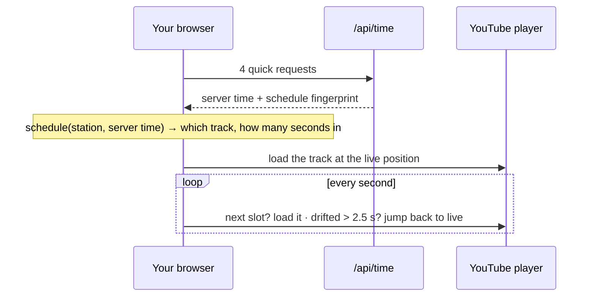

<div align="center">

# Neon Palms Radio

**Three stations. One endless summer.** · 107.7 · 85.5 · 88.6

An unofficial fan web radio with an 80s neon-sunset soul: three stations, one tap apart.<br>
Everyone on the same station hears the same song at the same moment — just like real radio.

[](https://github.com/MrScalo/neon-palms-radio/actions/workflows/ci.yml)


[](LICENSE)

**[▶ Listen live: neon-palms-radio.vercel.app](https://neon-palms-radio.vercel.app)**


</div>

## What it is

Neon Palms Radio is a small network of three web radio stations. The music comes from **official
music videos** on the artists' and labels' own YouTube channels, played in YouTube's embedded player —
so anyone can listen to full songs without an account.

The twist: it behaves like a real broadcast. There is no skip, no seek, no playlist to click through.
Pick a station, tune in, and you land in the middle of whatever is on air right now — the same song,
at the same second, as everyone else on that station.

## The stations

| Preset | Station        | Dial  | What's on                                                                                                                                                                                      |
| :----: | -------------- | ----- | ---------------------------------------------------------------------------------------------------------------------------------------------------------------------------------------------- |
|   1    | **Heatwave**   | 107.7 | _Fresh from the trailers._ Songs officially revealed so far for the most anticipated return to the neon coast — from trailers, first looks and radio previews to the official album and score. |
|   2    | **Rearview**   | 85.5  | _Classics from the in-game dial._ Eighties cuts that once played on the car radios of a legendary open-world crime saga — from the neon coast to the West Coast.                               |
|   3    | **Neon Palms** | 88.6  | _Pure 80s. No strings attached._ No game history, no cameos — just the decade's biggest hits with the same sunset feeling.                                                                     |

Heatwave is the default station. Songs on the first two can carry a discreet note on where they were
heard — _Trailer 2 · 2025_, _In-game radio · 2002, 2006_ — shown with the song.

<table>
<tr>
<td width="62%" valign="top">

### Features

- **Three stations, one tap apart** — presets like a car radio, each showing what its station is
  playing right now.
- **Live for everyone** — a shared station clock keeps all listeners of a station in sync (two
  browsers measured 0.3 s apart), with automatic track changes and drift correction.
- **Real radio controls** — tune in / tune out, switch stations, volume, mute. That's it.
- **On-air feel** — a studio-style ON AIR lamp, a LIVE pill when you're tuned in, Now Playing with a
  live progress bar, the next three songs, and a ticker of station bulletins.
- **Hand-picked tracks** — each one verified as an official upload. The lists live in
  [`src/data/stations/`](src/data/stations) and on the site's _Rotation_ page.
- **Shareable** — the page address shows the station you picked, so a link opens the same station.
- **Works before consent** — Now Playing, Up Next and the presets are computed locally, so the page
  is useful even if you never load YouTube.
- **Privacy by design** — nothing touches Google until you click _Accept & tune in_.
- **Original artwork** — the sun, palms and neon grid are hand-made CSS/SVG. No images, no fonts or
  scripts from third-party CDNs.
- **Responsive and accessible** — from 320 px phones to wide screens, keyboard friendly, honours
  _reduced motion_.

</td>
<td width="38%" valign="top" align="center">


</td>
</tr>
</table>

## How “live” works without a streaming server

There is no audio stream and no backend state. Every browser computes the same programme for every
station from the same track lists and the same clock, then points its own YouTube player at the right
second of the station you picked.



- **Station epoch.** The network “went on air” on 1 January 2026, 00:00 UTC
  ([`schedule.ts`](src/lib/radio/schedule.ts)). For each station, time since then is cut into
  cycles; each cycle plays every track of that station exactly once, so a cycle is as long as the
  station's whole list.
- **Same shuffle everywhere.** The cycle number, mixed with a stable hash of the station's id, seeds
  a small integer-only random generator, so every browser and JavaScript engine produces the identical
  order — and every station its own. No artist plays twice in a row whenever a station's list allows
  it, not even across the boundary between two cycles.
- **Server clock, not your clock.** [`clock.ts`](src/lib/radio/clock.ts) measures the offset to the
  server time, so a wrong computer clock doesn't matter. It re-syncs every 10 minutes and when you
  return to the tab.
- **Staying on air.** The [engine](src/lib/radio/engine.ts) follows the schedule every second, loads
  the next track exactly at the slot boundary and seeks back to the live position after buffering or a
  network hiccup. Temporary errors are retried; videos YouTube refuses are skipped until the next slot.
- **Playlist updates.** `/api/time` also returns a fingerprint of all stations' track lists. A tab
  that was opened before an update shows a notice with a _Re-tune_ button instead of silently playing
  a different programme.

### Switching stations

- All three stations are always on air, whether anyone listens or not. Switching away and back lands
  you wherever that station is now — not where you left it.
- Tuned in, picking a preset loads that station's live position into the same player right away,
  inside your click, so the browser keeps the sound on. Tuned out, it only changes the selection.
- The address shows the selected station (`/?station=rearview`) so links can be shared. Nothing is
  stored; an unknown station falls back to Heatwave.

## Privacy by design

|                       | Before consent                                                                          | After “Accept & tune in”                                                                                                                                          |
| --------------------- | --------------------------------------------------------------------------------------- | ----------------------------------------------------------------------------------------------------------------------------------------------------------------- |
| Requests              | Our own server only                                                                     | + `www.youtube.com` (IFrame API script) and `www.youtube-nocookie.com` (player), which in turn loads the video, images and possibly ads from other Google servers |
| Cookies               | None                                                                                    | YouTube may set its own cookies                                                                                                                                   |
| Stored on your device | Nothing — after _Not now_, only that choice in `localStorage` (`neonpalms.consent.v1`)¹ | Your choice in `localStorage` (`neonpalms.consent.v1`)¹                                                                                                           |
| Selected station      | Only in the page address (`?station=…`)                                                 | Only in the page address (`?station=…`)                                                                                                                           |
| Fonts                 | Self-hosted via `next/font`                                                             | Self-hosted via `next/font`                                                                                                                                       |

¹ If the track lists change while a page is open, it may reload itself into the new programme; it
notes the new version tag in `sessionStorage` so it can't reload in a loop.

- The consent card says exactly what will load and links to the privacy policy and YouTube's Terms of
  Service. _Not now_ is one click and is remembered without nagging.
- Consent can be withdrawn on every page under **Privacy settings** in the footer — the player is torn
  down immediately, in every open tab.
- A Content-Security-Policy ([`next.config.ts`](next.config.ts)) only allows those two YouTube hosts as
  third parties. No analytics, no ads of our own, no tracking.

## Playing by YouTube's rules

The site follows the [YouTube API Services policies](https://developers.google.com/youtube/terms/developer-policies)
for embedded players:

- The player is always visible (at least 200 × 200 px) and nothing is ever drawn on top of it.
- **No background playback.** When you switch to another tab, the station pauses; when you come back,
  it jumps straight back to the live position. The next track only starts by itself while at least
  half of the player is on screen.
- Switching stations only ever happens on your click, in the same visible player.
- Only documented player parameters are used. If you pause by clicking the video, a _Back to live_
  button takes you back to the broadcast.

## Getting started

Requires **Node.js 20.9+** (CI uses Node 24).

```bash
git clone https://github.com/MrScalo/neon-palms-radio.git
cd neon-palms-radio
npm ci
npm run dev
```

Then open <http://localhost:3000>.

| Command                   | What it does                                                           |
| ------------------------- | ---------------------------------------------------------------------- |
| `npm run dev`             | Development server                                                     |
| `npm run build`           | Production build                                                       |
| `npm start`               | Serve the production build                                             |
| `npm test`                | Unit tests (Vitest) — schedule, clock, consent, engine, UI helpers     |
| `npm run typecheck`       | TypeScript check                                                       |
| `npm run lint`            | ESLint                                                                 |
| `npm run verify:playlist` | Re-checks every track on every station against YouTube (needs internet) |

> This project uses Next.js 16 with `cacheComponents`. Its APIs differ from older versions — the
> bundled docs in `node_modules/next/dist/docs/` are the reference.

## Project structure

```text
src/
├── app/
│   ├── page.tsx                 # the radio
│   ├── api/time/route.ts        # station clock (dynamic, never cached)
│   ├── rotation/                # every station's tracks with links to the official videos
│   ├── privacy/ · imprint/      # privacy policy and legal notice
│   └── not-found.tsx            # “Dead air.”
├── components/
│   ├── radio/                   # set, presets, controls, now playing, up next, ticker
│   │   └── scene/               # sun, palms, stars and grid (pure SVG/CSS)
│   └── legal/                   # footer with privacy settings, legal page layout
├── config/
│   ├── site.ts                  # network name + operator details
│   └── stations.ts              # the stations: name, dial, tagline, description, accent colour
├── data/stations/<id>.json      # each station's tracks
├── hooks/useRadio.ts            # React hook around the engine and the selected station
└── lib/
    ├── consent.ts               # consent store (synced across tabs)
    └── radio/
        ├── schedule.ts          # deterministic programme per station
        ├── clock.ts             # server clock offset
        ├── engine.ts            # keeps the YouTube player on air
        └── youtube.ts           # IFrame API loader
scripts/verify-videos.mjs        # checks uploads: channel, length, embeddable, age gate, region
```

## Adding or replacing a track

1. Find the **official upload** — on the artist's channel (verified artist badge or VEVO) or the
   record label's official channel. No Topic channels, fan uploads, lyric videos by third parties,
   remixes or live recordings.
2. Check it:
   ```bash
   node scripts/verify-videos.mjs <videoId>
   ```
   It prints the uploader, `lengthSeconds`, channel badges, embeddability, age gate and availability in
   Germany. `ok` must be `true` (the only exception is an official channel that YouTube shows without
   a badge — see step 3).
3. Add it to the station's file, `src/data/stations/<id>.json`:
   ```json
   { "id": "<videoId>", "artist": "…", "title": "…", "year": 1984, "duration": 238, "channel": "…", "heardIn": "…" }
   ```
   - `duration` must equal `lengthSeconds` **exactly** — it drives the shared schedule.
   - `channel` must equal the uploader exactly — it's shown as the official-upload credit.
   - `heardIn` is a short, discreet note on where the song was heard:
     - **heatwave:** `"<source> · <year>"`, where the source is one of `Trailer 1`, `Trailer 2`,
       `Launch trailer`, `Extended look`, `Teaser`, `Radio preview`, `Official album`,
       `Original score` or `Official playlist` — e.g. `"Trailer 2 · 2025"`.
     - **rearview:** `"In-game radio · <years>"` — e.g. `"In-game radio · 2002, 2006"`. The years are
       the release years of the games whose radio played the song; a song added to a game later still
       gets that game's year.
     - **neonpalms:** leave it out.
   - Add `officialNote` whenever YouTube shows no badge for an official upload (a label channel, an
     unmerged VEVO channel, the artist's own unbadged channel, or a joint upload that hides the badge),
     explaining why it's official.
   - A video belongs to one station only.
4. Run `npm run verify:playlist`. It checks every station's file — duration and channel name must
   match YouTube exactly, and no video may be on two stations — and every track must report OK.

Changing a station's list re-times that station's programme (the others keep running unchanged), and
open tabs are asked to re-tune. Videos can be removed or blocked at any time, so re-run
`npm run verify:playlist` now and then.

**Station details** — name, dial frequency, tagline, description and accent colour — live in
[`src/config/stations.ts`](src/config/stations.ts). The order there is the preset order; the first
station is the default.

## Deploying

The radio is made for **Vercel**: import the repository at
[vercel.com/new](https://vercel.com/new) and deploy — no settings or environment variables needed.
[`vercel.json`](vercel.json) runs the server functions (the station clock) in Frankfurt (`fra1`);
pages are served from Vercel's global CDN.

Any other host works too as long as it runs Node.js (`npm run build` + `npm start`) — `/api/time`
must answer every request live, so a static export won't work.

**Running your own copy?**

- [ ] Put your own operator and hosting details into [`src/config/site.ts`](src/config/site.ts). A
      value in `[brackets]` counts as a placeholder and makes `/privacy` and `/imprint` show a
      “Draft” note.
- [ ] Read both legal pages once more — the hosting section describes Vercel. On another host,
      adjust it, including the legal basis if data leaves the EU/EEA.
- [ ] The legal notice cites § 18 (1) MStV for a private, non-commercial site. If the site becomes
      commercial, switch to § 5 DDG and add a second direct contact channel.
- [ ] After deploying, check that the security headers are served and the player still starts.
- [ ] Run `npm run verify:playlist`.

## Disclaimer

Neon Palms Radio is an unofficial, non-commercial fan project. It is not affiliated with, endorsed or
sponsored by any video game publisher or developer, by YouTube or Google, or by any of the artists or
record labels whose music it plays. Its look is an original homage to the neon-and-sunset aesthetics of
the 1980s; station names, descriptions and artwork are original, and it uses no logos or artwork from
any game.

This repository contains no music or video files. All music videos are played from the official
YouTube channels of the respective artists and labels through YouTube's embedded player; all rights
remain with their owners.

## License

The source code is released under the [MIT License](LICENSE). It covers the code and the original
artwork in this repository only — not the music, music videos, artist names or song titles referenced
in the track lists, which belong to their respective owners.
